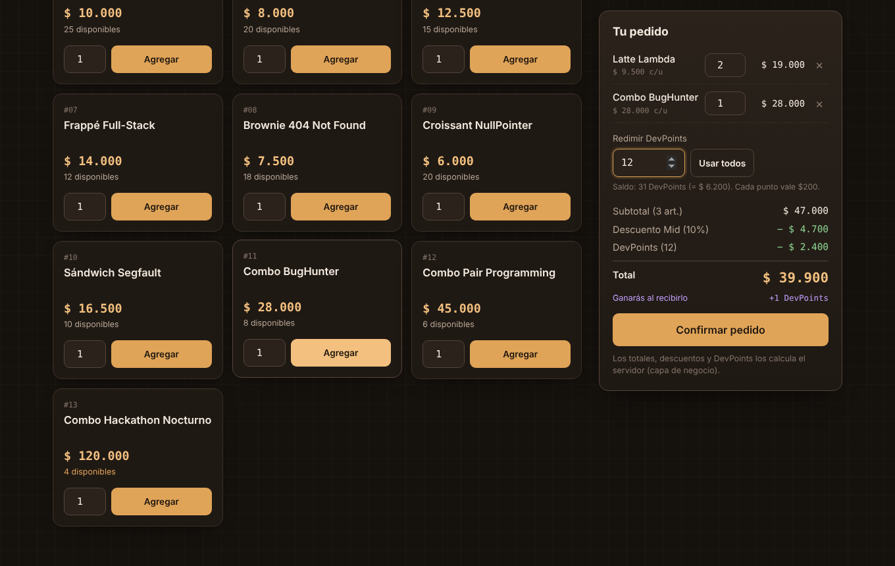
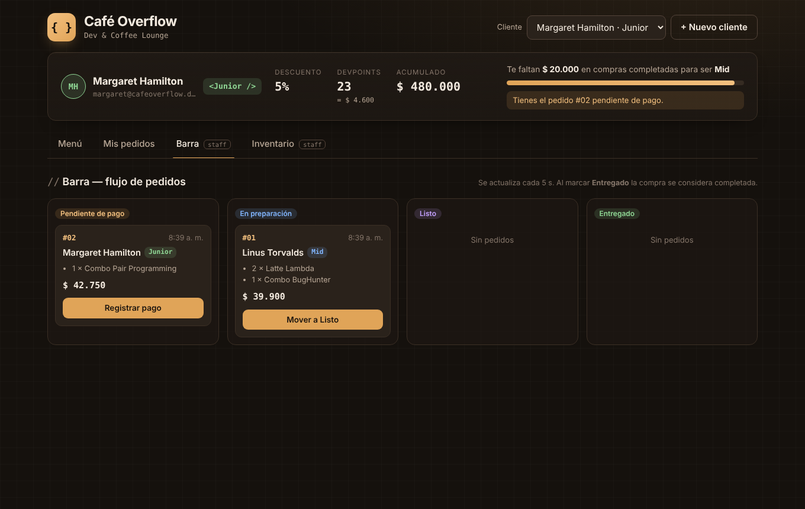
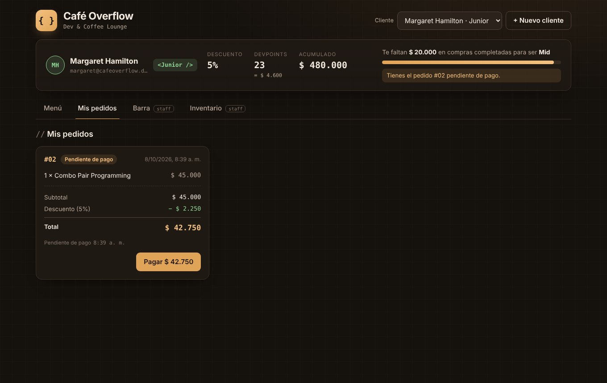
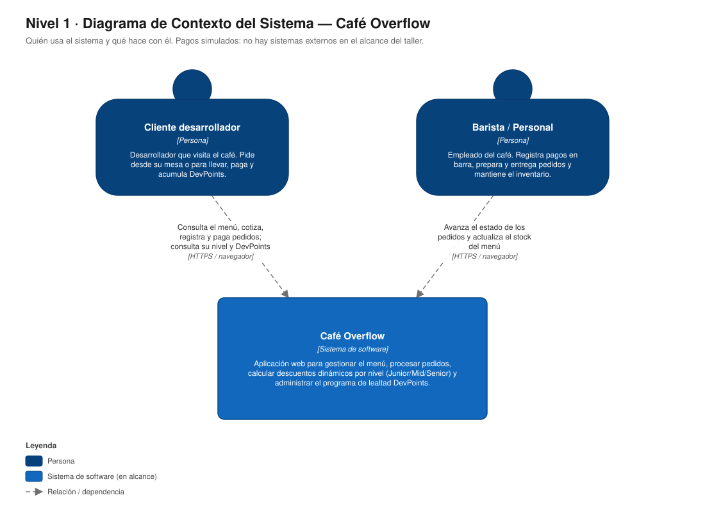
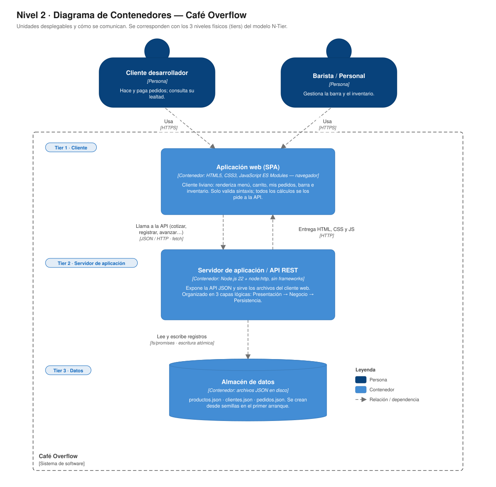
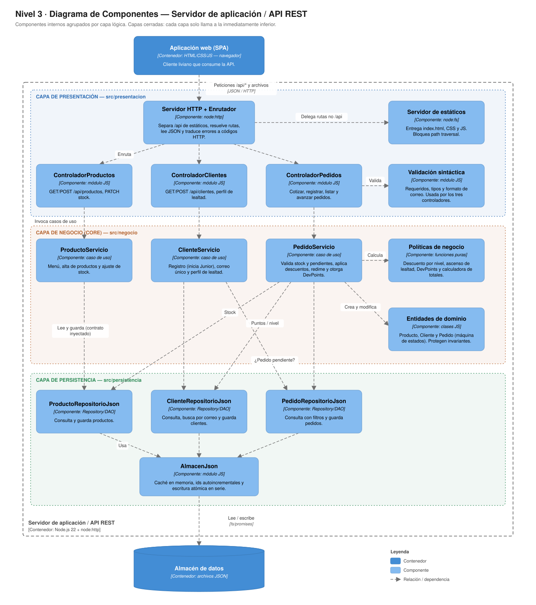

# ☕ Café Overflow — Dev & Coffee Lounge

Aplicación web para un café temático de desarrolladores: menú, pedidos en línea (en mesa o para llevar), descuentos dinámicos por **categoría de desarrollo** (Junior / Mid / Senior) y programa de lealtad **DevPoints**.

> **Taller: Modelo N-Tier** · Arquitectura de Software · UNAB
> Arquitectura lógicamente dividida en **3 capas** (Presentación, Negocio, Persistencia) garantizando **Separación de Responsabilidades (SoC)** y **Aislamiento de Capas (Layers of Isolation)**. Desarrollada **sin frameworks**: Node.js nativo (`node:http`, `node:fs`) en el servidor y HTML + CSS + JavaScript puro en el navegador. Cero dependencias en `package.json`.



---

## Contenido

1. [Cómo ejecutarlo](#1-cómo-ejecutarlo)
2. [Diagramas C4](#2-diagramas-c4-niveles-1-2-y-3)
3. [Arquitectura en capas](#3-arquitectura-en-capas)
4. [Reglas de negocio](#4-reglas-de-negocio-y-dónde-viven)
5. [API REST](#5-api-rest)
6. [Supuestos y decisiones de diseño](#6-supuestos-y-decisiones-de-diseño)

---

## 1. Cómo ejecutarlo

Requisito: **Node.js 22 o superior**. No hay que instalar nada más (`npm install` no es necesario).

```bash
npm start          # inicia en http://localhost:3000
npm run reset      # borra los datos y los restaura desde las semillas
```

Variables opcionales: `PORT` (por defecto `3000`) y `DATOS_DIR` (por defecto `./datos`).

En el primer arranque se crea la carpeta `datos/` con productos y 4 clientes de ejemplo:

| Cliente | Nivel | Acumulado | DevPoints | Para probar… |
|---|---|---|---|---|
| Ada Lovelace | Junior | $85.000 | 4 | Cliente nuevo típico |
| Margaret Hamilton | Junior | $480.000 | 23 | **Ascenso a Mid** con una compra ≥ $20.000 |
| Linus Torvalds | Mid | $640.000 | 31 | Descuento del 10 % |
| Grace Hopper | Senior | $1.720.000 | 85 | Descuento del 15 % |

**Recorrido sugerido:** elige a Margaret → agrega productos en *Menú* → confirma → en *Mis pedidos* paga → en *Barra* avánzalo hasta *Entregado* → verás el aviso de ascenso a **Mid** y sus nuevos DevPoints.

| Barra (staff) | Mis pedidos |
|---|---|
|  |  |

---

## 2. Diagramas C4 (niveles 1, 2 y 3)

Los diagramas están en [`docs/c4/`](docs/c4) en tres formatos: **SVG** (vectorial), **PNG** y **PlantUML** (`.puml`, con [C4-PlantUML](https://github.com/plantuml-stdlib/C4-PlantUML), editables en <https://www.plantuml.com/plantuml>).

### Nivel 1 — Contexto del sistema


### Nivel 2 — Contenedores
Cada contenedor corresponde a un **nivel físico (tier)**: navegador → servidor de aplicación → almacén de datos.



### Nivel 3 — Componentes del servidor de aplicación
Los componentes se agrupan por **capa lógica (layer)**.



---

## 3. Arquitectura en capas

### Capas (lógicas) vs. niveles (físicos)

| | Capas lógicas (*layers*) | Niveles físicos (*tiers*) |
|---|---|---|
| Qué son | Organización del código | Dónde se ejecuta cada parte |
| En este proyecto | `presentacion/` · `negocio/` · `persistencia/` | Navegador · Proceso Node.js · Archivos JSON |
| Comunicación | Llamadas en memoria dentro del mismo proceso | Red (HTTP/JSON) y disco |

### Estructura de carpetas

```
cafe-overflow/
├── src/
│   ├── index.js                  ← punto de entrada (arranca el servidor)
│   ├── app.js                    ← RAÍZ DE COMPOSICIÓN: conecta las 3 capas por inyección
│   │
│   ├── presentacion/             ── CAPA DE PRESENTACIÓN ──────────────────────
│   │   ├── index.js              ← arma rutas + servidor HTTP
│   │   ├── servidor/             ← node:http, enrutador, estáticos, mapeo de errores→HTTP
│   │   ├── controladores/        ← traducen HTTP ⇄ casos de uso (sin reglas)
│   │   ├── validacion/           ← validación SINTÁCTICA de solicitudes
│   │   └── web/                  ← cliente liviano: index.html, css/, js/
│   │
│   ├── negocio/                  ── CAPA DE NEGOCIO (CORE) ────────────────────
│   │   ├── index.js              ← fábrica de servicios
│   │   ├── servicios/            ← casos de uso: Producto, Cliente, Pedido
│   │   ├── entidades/            ← Producto, Cliente, Pedido (máquina de estados)
│   │   ├── reglas/               ← descuentos, lealtad, DevPoints, calculadora
│   │   ├── contratos/            ← interfaces que se esperan de la persistencia
│   │   ├── errores/              ← ErrorNegocio (códigos semánticos, sin HTTP)
│   │   └── comun/                ← Mutex (evita sobreventa en concurrencia)
│   │
│   └── persistencia/             ── CAPA DE PERSISTENCIA Y DATOS ──────────────
│       ├── index.js              ← fábrica de repositorios JSON
│       ├── AlmacenJson.js        ← lectura/escritura atómica de archivos JSON
│       ├── repositorios/         ← patrón Repository/DAO
│       └── semillas/             ← datos iniciales
│
├── docs/c4/                      ← diagramas C4 (SVG, PNG, PlantUML)
└── scripts/restablecerDatos.js
```

### Reglas de dependencia (capas cerradas)

```
 Navegador (web/)  ──HTTP/JSON──▶  Presentación  ──▶  Negocio  ──▶  Persistencia  ──▶  datos/*.json
                                                        ▲               │
                                                        └─ contratos ───┘  (inyección de dependencias)
```

- **Presentación** solo llama a **Negocio**. Nunca toca la persistencia.
- **Negocio** no importa ningún módulo de las otras capas ni de Node (`fs`, `http`). Recibe los repositorios ya construidos a través de su constructor (**inversión e inyección de dependencias**), definidos en [`negocio/contratos/repositorios.js`](src/negocio/contratos/repositorios.js).
- **Persistencia** no conoce el negocio: guarda y devuelve objetos planos.
- **`app.js`** es el único archivo que conoce las tres capas, y solo para conectarlas.

Puedes comprobarlo revisando los `import` de cada archivo: ningún archivo de `negocio/` importa de `presentacion/` ni de `persistencia/`, y ningún archivo de `presentacion/` importa de `persistencia/`.

### Cumplimiento de las restricciones del taller

| Capa | Permitido (y dónde se hace) | Prohibido (y cómo se garantiza) |
|---|---|---|
| **Presentación** | Renderizar vistas (`web/js/vistas.js`), capturar formularios (`web/js/app.js`), validar sintaxis: requeridos y formato de correo (`web/js/validacion.js` en el navegador y `validacion/validacionSintactica.js` en el servidor). | No calcula totales, descuentos, subtotales ni progreso de nivel: el carrito pide todo a `POST /api/pedidos/cotizacion` y la tarjeta de lealtad muestra lo que devuelve el perfil del cliente. No consulta datos directamente: solo usa `web/js/api.js`. |
| **Negocio** | Cálculo de descuentos, ascenso Junior → Mid → Senior, verificación de stock y gestión del estado del pedido (`reglas/`, `entidades/`, `servicios/`). | No genera HTML ni JSON (la serialización la hace `servidor/utilidadesHttp.js`), no conoce HTTP (lanza `ErrorNegocio` con códigos semánticos que la presentación traduce) y no ejecuta consultas: usa los contratos de repositorio. |
| **Persistencia** | Consultar, guardar y actualizar en archivos JSON (`AlmacenJson`, `repositorios/`). | No evalúa reglas: solo filtra por igualdad de campos; no conoce niveles, descuentos ni DevPoints. |

### Patrones y principios aplicados

- **Separación de responsabilidades (SoC)** y **SRP**: cada módulo tiene una sola razón para cambiar (p. ej. `politicaDescuentos.js` solo cambia si cambian los porcentajes).
- **Cliente liviano (Thin Client)**: la UI solo renderiza y valida sintaxis.
- **Repository / DAO**: `RepositorioJson` y sus especializaciones.
- **Inyección de dependencias** + **Raíz de composición**: permite cambiar JSON por SQLite/PostgreSQL/MongoDB creando otra fábrica en `persistencia/` sin tocar el negocio, y permite probar el negocio con repositorios en memoria.
- **Máquina de estados** en la entidad `Pedido`.
- **Alta cohesión / bajo acoplamiento**: las capas se comunican por interfaces pequeñas.

---

## 4. Reglas de negocio y dónde viven

| # | Regla | Implementación |
|---|---|---|
| 1 | Descuento por nivel: Junior 5 %, Mid 10 %, Senior 15 % | [`reglas/politicaDescuentos.js`](src/negocio/reglas/politicaDescuentos.js) |
| 2 | Todo cliente nuevo inicia Junior con $0 | [`entidades/Cliente.js`](src/negocio/entidades/Cliente.js) → `Cliente.registrar` |
| 2 | Ascenso automático: ≥ $500.000 → Mid · ≥ $1.500.000 → Senior | [`reglas/politicaLealtad.js`](src/negocio/reglas/politicaLealtad.js) + `Cliente.registrarCompraCompletada` |
| 3 | 1 DevPoint por cada $20.000 de un pedido completado | [`reglas/politicaDevPoints.js`](src/negocio/reglas/politicaDevPoints.js) |
| 3 | Cada DevPoint = $200 de descuento, redimible en la siguiente compra | `politicaDevPoints.js` + [`reglas/calculadoraPedido.js`](src/negocio/reglas/calculadoraPedido.js) |
| 4a | No se registra un pedido si la cantidad supera el stock | `Producto.verificarStock` / `descontarStock` |
| 4b | No se registra un pedido si el cliente tiene otro *Pendiente de pago* | [`servicios/PedidoServicio.js`](src/negocio/servicios/PedidoServicio.js) → `registrar` |
| — | Flujo de estados: Pendiente de pago → En preparación → Listo → Entregado | [`entidades/Pedido.js`](src/negocio/entidades/Pedido.js) |

**Cálculo del total** (`calculadoraPedido.js`):

```
subtotal          = Σ precioUnitario × cantidad
descuentoNivel    = round(subtotal × % del nivel)
descuentoDevPoints= min(puntos solicitados, ⌊(subtotal − descuentoNivel) / 200⌋) × 200
total             = subtotal − descuentoNivel − descuentoDevPoints
```

---

## 5. API REST

| Método | Ruta | Descripción |
|---|---|---|
| `GET` | `/api/productos` | Menú con precio y stock |
| `POST` | `/api/productos` | Crear producto `{ nombre, precio, stock }` |
| `PATCH` | `/api/productos/:id/stock` | Ajustar stock `{ stock }` |
| `GET` | `/api/clientes` | Clientes con su perfil de lealtad |
| `POST` | `/api/clientes` | Registrar cliente `{ nombre, correo }` (inicia Junior) |
| `GET` | `/api/clientes/:id` | Perfil: nivel, % descuento, DevPoints, progreso, pedido pendiente |
| `POST` | `/api/pedidos/cotizacion` | Calcula el desglose **sin registrar** `{ clienteId, items[], devPointsARedimir }` |
| `POST` | `/api/pedidos` | Registra el pedido (mismas reglas + descuenta stock y puntos) |
| `GET` | `/api/pedidos?clienteId=&estado=` | Lista pedidos con filtros opcionales |
| `GET` | `/api/pedidos/:id` | Detalle de un pedido |
| `POST` | `/api/pedidos/:id/avanzar` | Avanza al siguiente estado; al *Entregado* devuelve `lealtad` (puntos ganados, ascenso) |

Errores: `{ "error": { "codigo", "mensaje", "detalles" } }` con `400` (sintaxis), `404` (no existe), `409` (stock, pedido pendiente, correo duplicado, transición inválida) o `422` (datos o DevPoints inválidos). La traducción código de negocio → HTTP está en [`presentacion/servidor/mapeoErrores.js`](src/presentacion/servidor/mapeoErrores.js).

Ejemplo:

```bash
curl -X POST http://localhost:3000/api/pedidos/cotizacion \
  -H "Content-Type: application/json" \
  -d '{"clienteId":3,"items":[{"productoId":3,"cantidad":2},{"productoId":11,"cantidad":1}],"devPointsARedimir":12}'
```

---

## 6. Supuestos y decisiones de diseño

- **"Compra completada" = pedido *Entregado*.** Solo entonces se suma al acumulado, se otorgan DevPoints y se evalúa el ascenso. El nuevo descuento aplica a partir de la siguiente compra.
- **El acumulado y los DevPoints se calculan sobre el total pagado** (después de descuentos).
- **Los DevPoints se descuentan al registrar el pedido.** Si el cliente pide redimir más de lo útil, solo se aplican los necesarios para no dejar el total en negativo (no se pierden puntos).
- **El pago es simulado:** pasar de *Pendiente de pago* a *En preparación* equivale a pagar (desde *Mis pedidos* o en *Barra*).
- **Un cliente puede ascender varios niveles de una vez** y **nunca desciende**.
- **Los ítems guardan nombre y precio del momento**, para que un cambio de precio no altere pedidos anteriores.
- **Concurrencia:** las operaciones que modifican stock, puntos o estados se serializan con un `Mutex` para evitar sobreventa.
- **Moneda:** pesos colombianos enteros; los descuentos se redondean al peso.
- Las pestañas *Barra* e *Inventario* son vistas de personal; la autenticación está fuera del alcance del taller.
